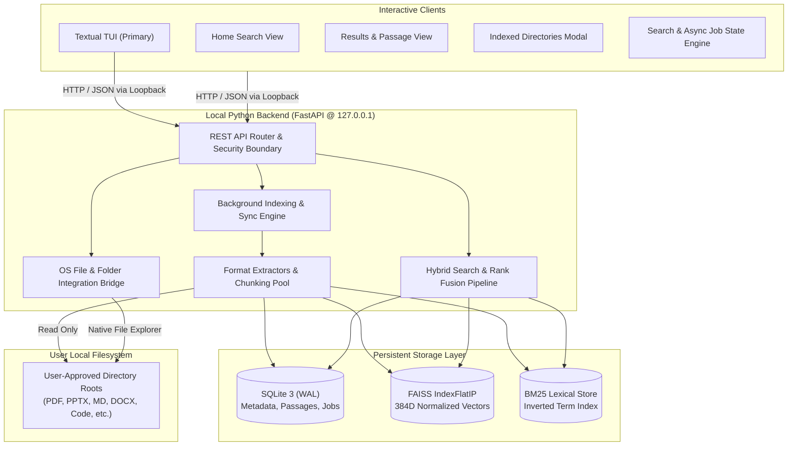
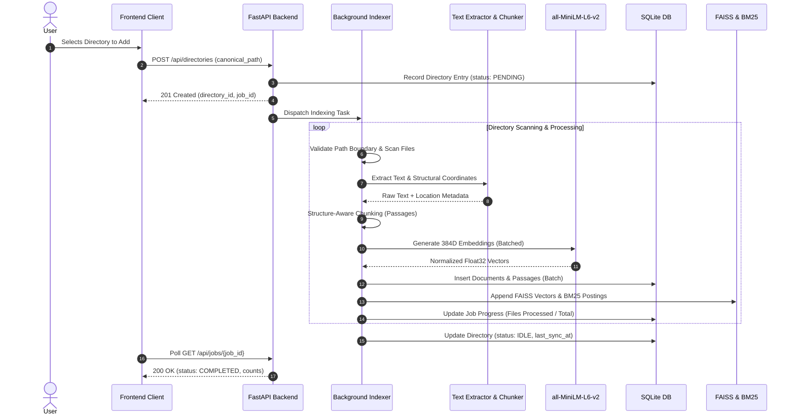
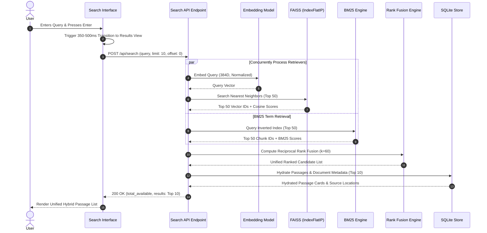

# System Architecture & Technical Design — FindIT

> **Document Status**: `APPROVED` | **Version**: 1.0  
> **Last Synchronized**: Based on Comprehensive Research & Technical Analysis  

---

## 1. System Topology & Architectural Overview

FindIT is architected as a **local-first desktop search engine** with a Python Textual TUI as its primary interactive client and a supported React + Vite client. Both communicate via HTTP/REST with one local Python + FastAPI backend service. The backend is the sole owner of indexing, storage, retrieval, and security policy.



---

## 2. Component Boundaries & Responsibilities

### 2.1 Frontend Client (React + TypeScript)
- **UI State Machine**: Orchestrates the view transitions between the homepage and the results view.
- **Continuous Header Animation**: Smoothly morphs the centered search input and logo into a compact persistent header upon submission.
- **Passage Inspector**: Presents faithful extracted text with query highlights and location coordinates.
- **Directory Manager Modal**: Manages registered folder roots, triggers sync operations, and monitors real backend job telemetry.
- **Concurrency & Race Condition Guard**: Uses `AbortController` and sequential request IDs to ensure older queries never overwrite newer search results.

### 2.2 Backend Service (FastAPI)
- **Security Boundary**: Enforces loopback binding (`127.0.0.1`), validates path canonicalization, and ensures requests remain within approved directory boundaries.
- **Document Extractors**: Modular parser suite extracting raw text and line/page/slide coordinates across supported formats.
- **Chunking Engine**: Segments extracted documents into location-aware passages (~250–500 tokens) with 20% overlap.
- **Embedding Service**: Executes local inference with `sentence-transformers/all-MiniLM-L6-v2`, returning 384-dimensional normalized vectors.
- **Retrieval & Fusion Engine**: Queries FAISS and BM25 concurrently, merges candidate pools using Reciprocal Rank Fusion ($k=60$), and hydrates metadata from SQLite.
- **OS Integration Bridge**: Dispatches native OS commands (e.g., `explorer.exe /select,` on Windows, `open -R` on macOS, `xdg-open` on Linux) to safely reveal files in their host directories.

### 2.3 Textual TUI (Primary Interactive Client)
- Uses the REST API only; it does not open the backend database or index files directly.
- Presents a persistent source/job context, hybrid result list, and selected-passage inspector on wide terminals, with navigable overlays/views on narrow terminals.
- Owns keyboard routing and focus, request identity/cancellation, selection by stable chunk ID, pagination, and recovery from backend or job errors.
- Starts and stops a backend child process only when it owns that process; an already-running backend is never terminated by the TUI.

---

## 3. Data Flow Pipelines

### 3.1 Indexing Pipeline Flow


---

### 3.2 Query & Hybrid Retrieval Pipeline Flow


---

## 4. Frontend Component & State Architecture

### 4.1 Component Hierarchy
```text
App
React client
├── HomeSearch (Visible in "home" mode)
│   ├── LogoBrand
│   ├── TaglineDisplay ("Find what you remember.")
│   └── CenteredSearchInput
├── CompactSearchHeader (Visible in "results" mode)
│   ├── CompactLogo
│   ├── HeaderSearchInput
│   └── DirectoryModalTrigger (Folder Icon)
├── SearchResultsContainer
│   ├── SearchResultsSummary (e.g. "7 matching passages across 5 files")
│   ├── SearchResultsList
│   │   └── SearchResultRow (Repeated per passage)
│   │       ├── FileTypeBadge
│   │       ├── FileMeta (Name, Location Badge, Abbreviated Path)
│   │       ├── PassageSnippetPreview
│   │       └── OpenFolderAction (Stops propagation)
│   ├── ShowMorePaginationControl
│   ├── EmptyResultsState
│   ├── LoadingResultsState
│   └── SearchErrorState
├── PassageInspectorModal (Triggered on row click)
│   ├── ModalHeader (Filename, Location Label, Path)
│   ├── FullPassageText (Query terms highlighted)
│   └── ActionFooter (Close, Open in Folder)
└── IndexedDirectoriesModal (Triggered via folder icon)
    ├── ModalHeader (Summary Counts, Sync All Button)
    ├── DirectoryList
    │   └── DirectoryRow (Sync, Remove, File Count, Status)
    ├── AddDirectoryButton (OS Picker Trigger)
    └── RealtimeJobProgressIndicator

Textual TUI
├── Search input and persistent result list
├── Directory/job context panel
├── Passage inspector view
├── Directory and sync command palette
└── Contextual help and error/recovery overlays
```

### 4.2 State Machine & Transition Logic
1. **View States**:
   - `HOME`: Clean viewport, centered search bar, hero branding.
   - `TRANSITIONING`: In-place animation running for 350–500ms; logo and search bar smoothly translate and scale toward the top header; query preserved; results summary begins fading in.
   - `RESULTS`: Header pinned at top, result stream populated, pagination active.
2. **Race Condition Prevention**:
   - Every submitted query increments an internal `activeRequestId`.
   - Before firing a new query, any running `AbortController.abort()` is executed.
   - When an API response returns, if its request ID does not match the active ID, the payload is silently dropped to prevent stale results from overwriting newer queries.

---

## 5. Storage & Index Lifecycle Architecture

### 5.1 Storage Layout on Disk
FindIT stores all internal application data inside a dedicated local application data directory (e.g., `~/.findit/` or `%APPDATA%/FindIT/`):
```text
~/.findit/
├── findit.db           # SQLite 3 Database (WAL mode)
├── findit.db-wal       # SQLite Write-Ahead Log
├── findit.db-shm       # SQLite Shared Memory
├── vector_index.faiss  # Serialized FAISS IndexFlatIP
├── bm25_index.bin      # Serialized BM25 Inverted Index
└── models/             # Cached sentence-transformers weights
```

### 5.2 Atomic Synchronization & Rebuild Guarantees
- **Index-Only Removal**: When a user removes a directory, SQLite deletes the directory entry, cascade-deleting associated documents and passages. The backend then rebuilds or prunes the FAISS and BM25 indices to maintain strict 1-to-1 parity.
- **Full Index Reconstruction**: In the event of application crash or index file corruption, the backend can rebuild the FAISS vector index and BM25 inverted index directly from the `passages` table in SQLite without re-reading the source files on disk.
