# Project Roadmap & Implementation Milestones — FindIT

> **Current Status**: `UNIFICATION COMPLETE` | FastAPI is authoritative, the Textual TUI is primary, React remains supported, and the duplicate CLI engine is retired.
> **Frontend Design Status**: `Textual TUI primary; React supported at core parity`
> **Backend & Integration Status**: `Unified backend contracts verified; release smoke checks documented below`

Release verification completed for the backend and primary TUI: 30 core backend tests, 8 end-to-end tests, and 2 Textual state/layout tests pass in `backend/.venv`. Frontend verification remains recorded from the prior checkpoint; no frontend files were changed in this follow-up.

---

## 1. Roadmap Overview & Phasing

The current modernization is delivered in five user-commit checkpoints: documentation/contracts, backend consolidation, Textual TUI, browser parity and CLI retirement, then release verification. Agents do not commit; the user commits each verified checkpoint.

The FindIT implementation roadmap is organized into 8 sequential milestones, moving from core foundation and extraction to dense vector retrieval, rank fusion, UI integration, and synchronization resilience.

```mermaid
gantt
    title FindIT Implementation Roadmap
    dateFormat  X
    axisFormat  Day %d

    section Foundation
    M1: Skeleton & Local Runtime       :m1, 0, 3
    M2: Directory Registration & Scan  :m2, after m1, 3

    section Core Pipeline
    M3: Extraction & Passage Chunking  :m3, after m2, 5
    M4: Semantic Index (FAISS)         :m4, after m3, 4
    M5: BM25 Lexical & RRF Fusion      :m5, after m4, 4

    section UI & Integration
    M6: Frontend UI & In-Place Search  :m6, after m5, 5
    M7: Sync Engine & Index Lifecycle  :m7, after m6, 4
    M8: Security Hardening & Polish    :m8, after m7, 3
```

---

## 2. Implementation Milestones

### Milestone 1 — Project Skeleton & Local Runtime (`COMPLETED`)
- **Scope**:
  - Initialize React + TypeScript + Vite frontend project structure.
  - Setup Python + FastAPI backend environment with strict loopback binding (`127.0.0.1`).
  - Configure SQLite database initialization with WAL mode.
  - Establish CORS allowlisting and `/api/health` diagnostic endpoint.
- **Exit Criteria**: Frontend client successfully communicates with the local FastAPI backend.

### Milestone 2 — Directory Registration & Scanning (`COMPLETED`)
- **Scope**:
  - Implement OS folder picker flow / directory registration endpoint.
  - Build directory scanner with path canonicalization and directory boundary validation.
  - Implement file discovery and file-type identification (PDF, PPTX, DOCX, MD, TXT, Code, Config).
  - Store registered directories in SQLite.
- **Exit Criteria**: User can register a local directory and view discovered document counts in the database.

### Milestone 3 — Extraction & Structure-Aware Passages (`COMPLETED`)
- **Scope**:
  - Implement format extractors with structural coordinate tracking:
    - PDF (`pymupdf`): Page numbers and page counts.
    - PPTX (`python-pptx`): Slide numbers and titles.
    - Markdown & Plain Text: 1-indexed line ranges and heading paths.
    - DOCX: Section headings and paragraph indices.
  - Implement structure-aware chunking engine (~350 tokens, 50-token overlap).
  - Ensure zero text bleeding across PPTX slide boundaries and PDF pages.
- **Exit Criteria**: Stored passages possess verifiable, trustworthy source location labels.

### Milestone 4 — Semantic Vector Indexing & BM25 Lexical Engine (`COMPLETED`)
- **Scope**:
  - Integrate `sentence-transformers/all-MiniLM-L6-v2` embedding model.
  - Generate 384-dimensional dense vectors and apply strict L2 normalization.
  - Construct and persist FAISS `IndexFlatIP` wrapped in `IndexIDMap2`.
  - Maintain `vector_id` $\leftrightarrow$ `chunk_id` mapping.
  - Implement BM25 lexical inverted index (`RobustBM25Okapi`) with identifier-aware tokenization.
- **Exit Criteria**: Given a query, FAISS returns top candidate chunk IDs with cosine similarity scores and BM25 returns exact keyword candidate chunks.

### Milestone 5 — BM25 Lexical Retrieval & Reciprocal Rank Fusion (`COMPLETED`)
- **Scope**:
  - Build BM25 inverted term index over passage texts.
  - Implement BM25 query execution returning top-50 lexical candidate chunks.
  - Implement Reciprocal Rank Fusion ($k=60$) combining FAISS and BM25 candidate ranks.
  - Implement Top-10 pagination and batch retrieval logic.
  - Build Passage Retrieval & Inspection API (`GET /api/passages/{id}`) with surrounding passage context.
  - Build Native OS Explorer launcher (`POST /api/open-location`, `POST /api/documents/{id}/open-folder`) with directory confinement protection.
- **Exit Criteria**: Single query produces a unified hybrid-ranked list of top passages with inspection and folder opening.

### Milestone 6 — Frontend UI & Continuous Search Transition (`COMPLETED`)
- **Scope**:
  - Implement the established visual design: warm ivory background, terracotta contours, clean typography.
  - Build the smooth 350–500ms in-place transition from Homepage to Results view.
  - Render unified passage result cards with filename, location badge, and path.
  - Build in-app Passage Inspector modal rendering full extracted text, surrounding context, and query highlights.
  - Implement native OS "Open in folder" bridge and real-time sync progress polling.
  - Configure Vite reverse proxy targeting `http://127.0.0.1:8000`.
- **Exit Criteria**: End-to-end search query from UI returns real passages with working inspection and folder opening.

### Milestone 7 — Sync Engine & Index Lifecycle (`COMPLETED`)
- **Scope**:
  - Implement incremental sync detecting added, modified, and deleted files via size and timestamps.
  - Build atomic index update and prune pipeline.
  - Implement index-only directory removal guaranteeing source file immutability.
  - Surface real backend pipeline stages and progress counts in UI.
- **Exit Criteria**: Repeated file modifications and directory removals leave the indices clean and synchronized.

### Milestone 8 — Security Hardening & Acceptance Verification (`COMPLETED`)
- **Scope**:
  - Validate directory boundary confinement and symlink traversal defenses.
  - Verify origin headers and structured error JSON responses for local service calls.
  - Handle corrupt files, 0-byte files, and oversized files (>50MB) gracefully without crashing worker.
  - Run benchmark test query suite and verify hybrid search latency strictly under 100ms on CPU (measured ~29ms).
  - Verify complete acceptance checklist (64/64 tests passing).
- **Exit Criteria**: All acceptance criteria pass and system is ready for v0.1.0 release.

---

## 3. Acceptance Verification Checklist

### UI & Interaction
- [x] Homepage matches established visual design (ivory canvas, terracotta contours).
- [x] Pressing `Enter` executes smooth in-place header animation (350–500ms) without page reload.
- [x] Query remains preserved and editable in the compact header.
- [x] Results view presents one unified hybrid list (no separate technical mode tabs).
- [x] Respects `prefers-reduced-motion` preferences.

### Search & Retrieval
- [x] Local embedding model produces 384D normalized vectors.
- [x] FAISS (`IndexFlatIP`) and BM25 candidate pools are fused via RRF ($k=60$).
- [x] Initial search displays top-10 passages with functional "Show more" batching.
- [x] Multiple passages from the same document can appear independently.
- [x] Clicking a result card opens the in-app Passage Inspector with faithful text.
- [x] Source location coordinates (Page X / Pages X–Y, Slide N, Lines X–Y) are accurate.
- [x] "Open in folder" opens the native file explorer without opening the passage modal.

### Indexing & Reliability
- [x] Indexing progress indicates real stages and real file counts.
- [x] Removing a directory removes internal index records only; original files are untouched.
- [x] Incremental sync updates modified files and purges deleted documents.
- [x] Local API binds strictly to `127.0.0.1` and blocks traversal outside approved roots.
- [x] No document content or queries are transmitted to external cloud services.

---

## 4. Future Backlog (v2.0+)

1. **Optical Character Recognition (OCR)**: Integrate local Tesseract / Apple Vision OCR for scanned, non-text PDFs.
2. **Direct Document Navigation**: Open native PDF viewers at exact page/bounding-box highlight coordinates.
3. **Filesystem Watching**: Real-time event-driven background sync via `watchdog` or OS file events.
4. **Approximate Vector Search (HNSW / IVF)**: Evaluate if corpus size exceeds 100,000 passages.
5. **Additional File Formats**: Support for EPUB, Jupyter Notebooks (`.ipynb`), and spreadsheets (`.xlsx`).
